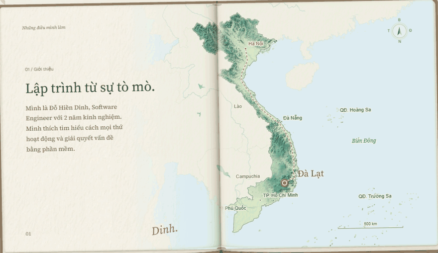

<p align="center">
  
</p>

# MyPortfolio

Portfolio cá nhân của **Đỗ Hiền Dinh**, Software Engineer tại Đà Lạt. Một cuốn sổ mở, bản đồ Việt Nam và hành trình cuộn dần tới Đà Lạt.

**[Xem website](https://cattfan.site/)** · **[GitHub profile](https://github.com/cattfan)** · **[Liên hệ](mailto:dohiendinh.work@gmail.com)**

<a href="https://cattfan.site/">
  <picture>
    <source media="(prefers-reduced-motion: reduce)" srcset="docs/github-profile/assets/portfolio.png" />
    
  </picture>
</a>

## Trải nghiệm

- Bản đồ dựng từ dữ liệu thật: địa hình, đường bờ biển và đường phố Đà Lạt chung một phép chiếu. Hiệu ứng zoom chạy theo cuộn trang, và tuyến đường đỏ tự vẽ từ Hà Nội tới Đà Lạt khi mở trang.
- Hành trình chạy cả trên laptop thấp và điện thoại nhỏ; trên điện thoại, bản đồ trải cả hai trang sách như một tấm atlas.
- Nội dung VI/EN, mặc định tiếng Việt và nhớ lựa chọn của người xem.
- Hai dự án trong khung cửa sổ trình duyệt/ứng dụng, ảnh tự chuyển sau 5 giây; gallery mở ảnh gốc và chi tiết mở trong hộp thoại.
- Header cố định (một hàng có menu trên điện thoại), sao chép email/số điện thoại, hỗ trợ bàn phím và giảm chuyển động.
- Ghi chú cuối sổ kể cách trang được làm và ghi công nguồn dữ liệu bản đồ.
- Bản production xuất tĩnh, phục vụ bằng Nginx trong Docker, kèm CSP và các header bảo mật.

## Công nghệ

Next.js · React · TypeScript · Tailwind CSS · Motion · d3-geo · Sharp · Playwright · Docker · Nginx · GitHub Actions

## Chạy tại máy

Cần Node.js 24+ và pnpm 11.25.0.

```sh
pnpm install --frozen-lockfile
pnpm --filter web dev
```

Mở `http://localhost:3000`.

```sh
pnpm --filter web lint
pnpm --filter web check-types
pnpm --filter web build
pnpm --filter web exec playwright install chromium
pnpm --filter web test:e2e
```

Kiểm thử trình duyệt cần website đang chạy. Đặt `PORTFOLIO_URL` để dùng địa chỉ khác; `PLAYWRIGHT_CHROMIUM_EXECUTABLE` để dùng Chromium đã cài. Mỗi push và pull request chạy lint, type-check, build image Docker và toàn bộ kiểm thử Playwright trên image đó ([CI](.github/workflows/ci.yml)).

## Docker

```sh
docker compose build
docker compose up -d
```

Mặc định chỉ mở ở `http://127.0.0.1:18088`. Xem [hướng dẫn triển khai](deploy/README.md) và [ghi chú bảo mật](deploy/SECURITY.md).

## Cấu trúc

| Thư mục               | Nội dung                                                        |
| --------------------- | --------------------------------------------------------------- |
| `apps/web`            | Ứng dụng portfolio, nội dung, component, assets và kiểm thử     |
| `packages`            | Cấu hình ESLint và TypeScript dùng chung trong workspace        |
| `deploy`              | Nginx, Docker, hướng dẫn triển khai và ghi chú bảo mật          |
| `scripts/capture`     | Công cụ chuẩn bị ảnh dự án và ảnh động giới thiệu               |
| `docs/github-profile` | README và assets cho trang cá nhân GitHub                       |
| `.github/workflows`   | CI: lint, type-check, Docker và kiểm thử Playwright             |

Sửa nội dung tiếng Việt tại [`portfolio.ts`](apps/web/content/portfolio.ts), tiếng Anh tại [`translations.ts`](apps/web/content/translations.ts). Chi tiết về bản đồ và hiệu ứng nằm trong [tài liệu ứng dụng](apps/web/README.md).

Mã nguồn ở đây là **website portfolio**. Các sản phẩm được giới thiệu có mã nguồn riêng. Nguồn và giấy phép bản đồ, ảnh tham khảo, font được ghi trên website, trong metadata và tệp license đi kèm; chúng không mặc nhiên thuộc cùng một giấy phép với mã nguồn.

---

**Đỗ Hiền Dinh** · [dohiendinh.work@gmail.com](mailto:dohiendinh.work@gmail.com) · +84 964 173 913
